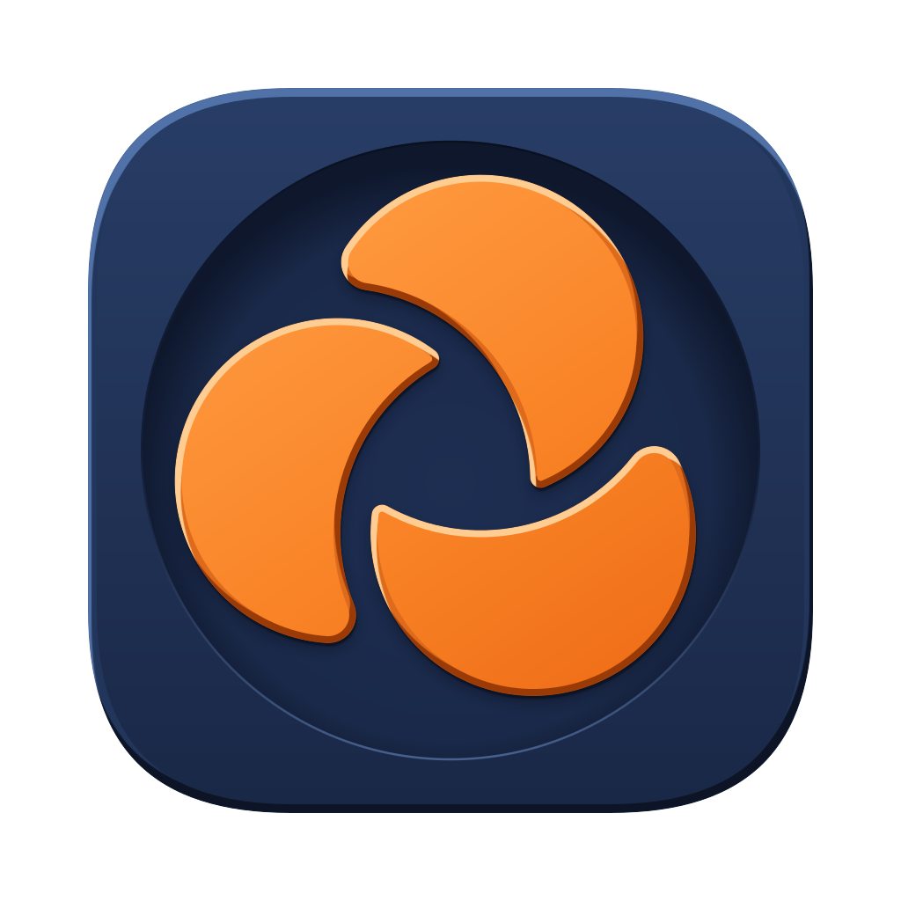

<p align="center">
  
</p>

# Busy

A small macOS menu bar app that keeps your Mac awake while you work.
Launch it from Applications or control the same session with the `busy` command.
When the session ends, Busy quits completely and lets normal sleep resume.

## Features

- **Stay awake for as long as you need.** Start an unlimited session or choose
  a duration from the menu bar or CLI. The display can still turn off.
- **Protect your battery.** Busy quits at or below a configurable battery level,
  defaulting to **20%**. The cutoff applies on battery power and takes priority
  over the timer. Your cutoff is remembered across launches.
- **Keep working with the lid closed.** The optional administrator-installed
  helper enables closed-lid operation, including on battery. It monitors battery
  level independently and restores sleep settings when the session ends or the
  app stops communicating.
- **Control one session from either interface.** See the battery level, cutoff,
  duration, and time remaining from the menu bar or terminal. JSON output is
  available for scripts.
- **A matching pair of icons.** A machined flywheel for the app and a simple
  rotor in the menu bar that adapts to light and dark backgrounds.

Quitting Busy releases its sleep prevention; it does not immediately put the
Mac to sleep. macOS idle timers and other apps can still keep it awake.

## Install

Download [Busy 0.1.1](Busy-0.1.1.pkg) and open the package.
This build requires **Apple silicon and macOS 14 or later**.

The installer adds `/Applications/Busy.app` and `/usr/local/bin/busy`.
It requires an administrator password and stops a running copy of Busy from
Applications before updating it. It first allows a normal quit, then force-stops
the app if it does not respond.

Select **Closed-lid helper** during installation if you want to use Busy with
the laptop lid closed. It is off by default on a fresh installation. An existing
helper is updated automatically and keeps its authorized user; on a fresh
installation, that user is the person logged in to the Mac.

After installation, open Busy from Applications or run `busy`. The installer
does not launch it automatically. The checked-in package is a local development
build, with an ad hoc app signature and no notarization.

## Command line

```sh
busy                         # Start if needed, then show status
busy status                  # Show status without starting the app
busy --duration 2h           # Start a new two-hour countdown
busy --duration unlimited    # Remove the countdown
busy --battery-cutoff 25     # Save a 25% battery cutoff
busy --duration 30m --battery-cutoff 20
busy status --json           # Machine-readable status
busy stop                    # Quit Busy and allow normal sleep
busy --help
```

Durations accept `s`, `m`, `h`, and `d`, from one second to 365 days.
Running plain `busy` while it is already active preserves the current countdown.
An explicit duration starts a fresh countdown. Durations are not remembered
between sessions: a new launch without a duration starts unlimited.

If your shell cannot find `busy`, add `/usr/local/bin` to your `PATH` or run
`/usr/local/bin/busy` directly.

## Build and test

Use macOS with Xcode and its command-line tools. There are no external package
dependencies. Builds target the architecture of the machine running the build.

```sh
./scripts/build.sh            # build/Busy.app and build/busy
./scripts/package.sh          # build/Busy-<version>.pkg
swift test
python3 scripts/test-cli.py build/busy
python3 Resources/Installer/test-scripts.py
```

For app lifecycle smoke tests, run `python3 scripts/test-cli.py build/busy --live`.
Those tests skip when the privileged helper is installed, to avoid changing
global sleep settings. Actual installer upgrades and physical closed-lid behavior
need to be checked on the target Mac.

Set `SIGNING_IDENTITY` for app signing and `INSTALLER_SIGNING_IDENTITY` for package
signing when producing a signed release. The packaging script does not notarize
the result. To run a development app through the CLI, set `BUSY_APP_PATH` to its
absolute `.app` path.

Icon sources live in [Resources/Icons](Resources/Icons). Regenerate the app icon
and menu bar images with `swift scripts/render-icons.swift`, then rebuild.
The renderer uses WebKit to preserve SVG filters and transparency.

## Remove the closed-lid helper

From a checkout of this repository:

```sh
busy stop
sudo ./scripts/uninstall-helper.sh
```

This restores the helper's saved sleep settings before removing it. Busy can
continue to prevent idle sleep without the helper, with the lid open.
